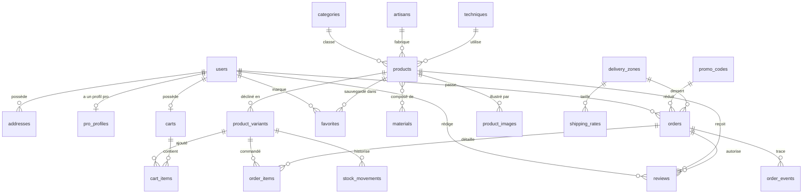

# Modèle de données (MCD / MLD) – Sunu Atelier

**Auteur** : Concepteur / analyste  
**Base de données** : MySQL / MariaDB (`sunu_atelier`), encodage `utf8mb4_unicode_ci`  
**Référence** : Cahier des charges v1.3 (sections 2.3, 2.6, 4.12, 7, 13.2)

---

## 1. Diagramme Entité-Relation (Mermaid)

---

## 2. Dictionnaire des tables (MLD)

### 2.1 Utilisateurs, adresses et espace pro
- **`users`** : `id`, `name`, `email` (unique), `phone` (index), `password` (bcrypt), `role` (`enum: client, pro, livreur, admin`, défaut `client`), `is_active` (bool), `remember_token`, `timestamps`.
- **`pro_profiles`** : `id`, `user_id` (FK unique), `company_name`, `ninea`, `trade_register`, `activity_type` (`boutique, hotel, decorateur, exportateur`), `contact_name`, `whatsapp`, `address`, `estimated_monthly_volume`, `discount_rate` (tinyint, 25 à 45), `status` (`en_attente, valide, refuse`), `timestamps`.
- **`addresses`** : `id`, `user_id` (FK), `label`, `full_name`, `phone`, `country`, `city`, `district`, `address_line`, `gps_hint`, `is_default` (bool), `timestamps`.

### 2.2 Catalogue artisanal
- **`categories`** : `id`, `name`, `slug` (unique), `description`, `header_image`, `sort_order`, `is_active`, `timestamps`.
- **`materials`** : `id`, `name`, `slug` (unique), `timestamps`.
- **`techniques`** : `id`, `name`, `slug` (unique), `timestamps`.
- **`artisans`** : `id`, `name`, `slug` (unique), `village`, `craft_specialty`, `bio`, `portrait_path`, `is_active`, `timestamps` *(fiche sans compte de connexion en V1)*.
- **`products`** : `id`, `category_id` (FK), `artisan_id` (FK nullable), `technique_id` (FK nullable), `title`, `slug` (unique), `sku` (unique), `availability_type` (`enum: en_stock, piece_unique, sur_commande`), `manufacturing_days` (int nullable), `price_public` (unsignedInt, FCFA), `price_compare_at` (unsignedInt nullable, prix barré), `price_pro` (unsignedInt nullable, jamais exposé au front public), `weight_grams` (unsignedInt), `dimensions`, `short_description`, `description`, `materials_story`, `care_instructions`, `authenticity_guarantee`, `model_3d_path` (nullable, V2), `is_bestseller` (bool, index), `is_new` (bool), `is_active` (bool, index), `timestamps`.
- **`material_product`** (table pivot) : `product_id` (FK), `material_id` (FK), clé primaire composite.
- **`product_variants`** : `id`, `product_id` (FK), `size` (nullable), `color` (nullable), `material_label` (nullable), `sku_suffix` (nullable), `stock_quantity` (unsignedInt, défaut 0), `low_stock_threshold` (unsignedInt, défaut 3), `is_active` (bool), `timestamps`.
- **`product_images`** : `id`, `product_id` (FK), `path` (WebP), `alt_text`, `sort_order`, `is_primary` (bool), `timestamps`.

### 2.3 Panier et favoris (persistés en base)
- **`carts`** : `id`, `user_id` (FK nullable, unique), `session_id` (string nullable, index), `promo_code_id` (FK nullable), `timestamps`.
- **`cart_items`** : `id`, `cart_id` (FK), `product_id` (FK), `product_variant_id` (FK), `quantity` (unsignedInt), `timestamps`. Contrainte unique `(cart_id, product_variant_id)`.
- **`favorites`** : `id`, `user_id` (FK nullable, index), `session_id` (string nullable, index), `product_id` (FK), `timestamps`.

### 2.4 Commandes, suivi et logistique
- **`delivery_zones`** : `id`, `name`, `type` (`local_senegal, pickup, international`), `description`, `estimated_delay`, `is_active`, `timestamps`.
- **`shipping_rates`** : `id`, `delivery_zone_id` (FK), `label`, `flat_rate` (unsignedInt, FCFA), `free_threshold` (unsignedInt nullable), `is_active`, `timestamps`.
- **`promo_codes`** : `id`, `code` (unique), `type` (`percentage, fixed`), `value` (unsignedInt), `min_order_amount` (unsignedInt, défaut 0), `max_uses` (unsignedInt nullable), `used_count` (unsignedInt, défaut 0), `starts_at`, `expires_at`, `is_active`, `timestamps`.
- **`orders`** :
  - `id`, `order_number` (unique, format `SA-AAMM-NNNN`), `tracking_token` (char(32) unique, hexadécimal).
  - `user_id` (FK nullable), `courier_id` (FK vers `users`, nullable), `promo_code_id` (FK nullable), `delivery_zone_id` (FK nullable).
  - Coordonnées : `civility`, `customer_name`, `customer_phone` (index), `customer_email`.
  - Livraison : `delivery_mode` (`domicile, retrait, international`), `delivery_country`, `delivery_city`, `delivery_address`, `postal_code`, `gps_landmark`, `delivery_slot`, `carrier_tracking_number` (nullable).
  - Montants (FCFA entiers) : `subtotal`, `discount_amount`, `shipping_amount`, `total_amount`.
  - Paiement simulé : `payment_method` (`carte_simulee, wave_simule, orange_money_simule, especes`), `payment_status` (`en_attente, paye, echoue`), `is_simulated_payment` (bool, défaut `true`).
  - Statut : `status` (`nouvelle, confirmee, en_preparation, livraison_programmee, prete_au_retrait, expediee, en_cours_de_livraison, livree, annulee`, index), `created_at` (index), `updated_at`.
- **`order_counters`** : `year_month` (char(4) PK, ex. `2611`), `last_sequence` (unsignedInt) — garantit l'unicité `SA-AAMM-NNNN` via `lockForUpdate()`.
- **`order_items`** : `id`, `order_id` (FK), `product_id` (FK nullable), `product_variant_id` (FK nullable), `product_title`, `variant_label`, `sku`, `unit_price`, `quantity`, `line_total`, `timestamps`.
- **`order_events`** : `id`, `order_id` (FK), `user_id` (FK nullable), `event_type`, `status_from`, `status_to`, `note`, `created_at` (index).

### 2.5 Avis, stocks, contacts et contenus administrables
- **`reviews`** : `id`, `product_id` (FK), `user_id` (FK), `order_id` (FK), `rating` (tinyint 1..5), `comment`, `photo_path` (nullable), `is_approved` (bool, défaut `false`), `timestamps`. Contrainte unique `(user_id, product_id, order_id)`.
- **`stock_movements`** : `id`, `product_variant_id` (FK), `user_id` (FK nullable), `type` (`production, vente, ajustement, annulation`), `quantity_delta` (int), `reason`, `created_at` (index).
- **`newsletter_subscribers`** : `id`, `email` (unique), `is_active`, `created_at`.
- **`contact_messages`** : `id`, `name`, `email`, `phone`, `subject`, `message`, `is_read`, `timestamps`.
- **`settings`** : `id`, `key` (unique), `value` (text nullable), `group`, `timestamps`.
- **`site_contents`** : `id`, `section_key` (unique), `title`, `subtitle`, `body` (text nullable), `image_path` (nullable), `meta_json` (json nullable), `timestamps`.

---

## 3. Règles de gestion critiques

1. **Disponibilité produit** :
   - `en_stock` : stock décrémenté par variante (`product_variants.stock_quantity`) avec `lockForUpdate()` dans la transaction de commande.
   - `piece_unique` : stock initial `1` ; passe à `0` lors de la commande (bloqué par verrouillage de ligne contre les commandes simultanées) et affiché « Indisponible / Vendue ».
   - `sur_commande` : pas de décrément de stock ; affiche `manufacturing_days` (délai de fabrication).
2. **Panier et favoris** : liés à `session_id` pour les invités ; à la connexion, fusion automatique dans le panier / favoris de `user_id` (en plafonnant aux stocks disponibles).
3. **Avis vérifiés** : seul un utilisateur connecté ayant une commande au statut `livree` contenant le produit peut publier un avis.
