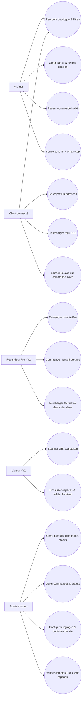
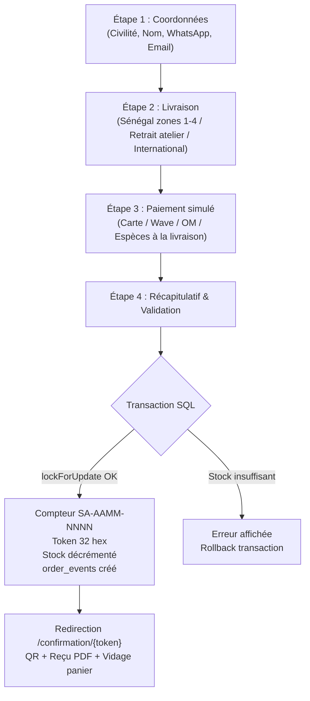
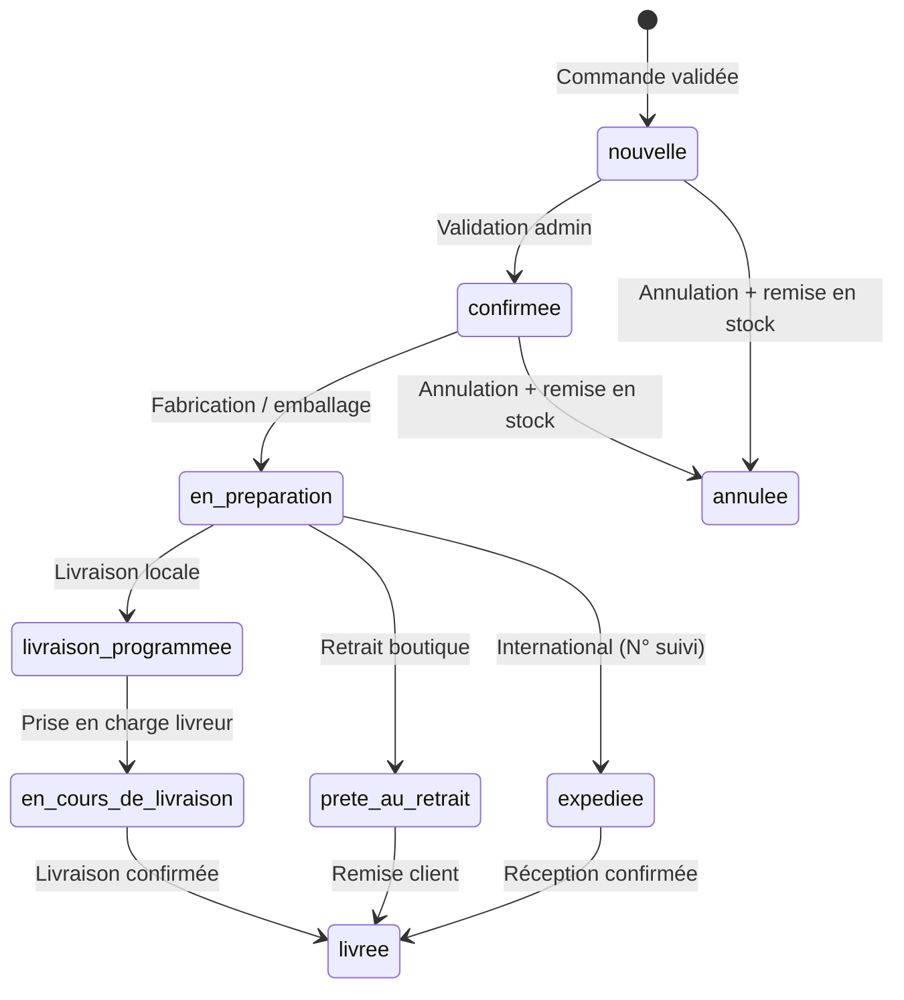

# Cas d'utilisation et Parcours de commande – Sunu Atelier

**Auteur** : Concepteur / analyste  
**Référence** : Cahier des charges v1.3 (sections 2.6, 2.7, 2.8, 2.9, 6, 13.3)

---

## 1. Cas d'utilisation par rôle

---

## 2. Parcours du tunnel de commande (`/commande`)

---

## 3. Cycle de vie des statuts de commande

### Statuts de paiement (V1 simulé)
- `en_attente` : paiement à la livraison / au retrait, ou en attente de validation.
- `paye` : simulation marquée « Succès » (ou espèces encaissées).
- `echoue` : simulation marquée « Échec » (le client peut réessayer ou changer de mode).
